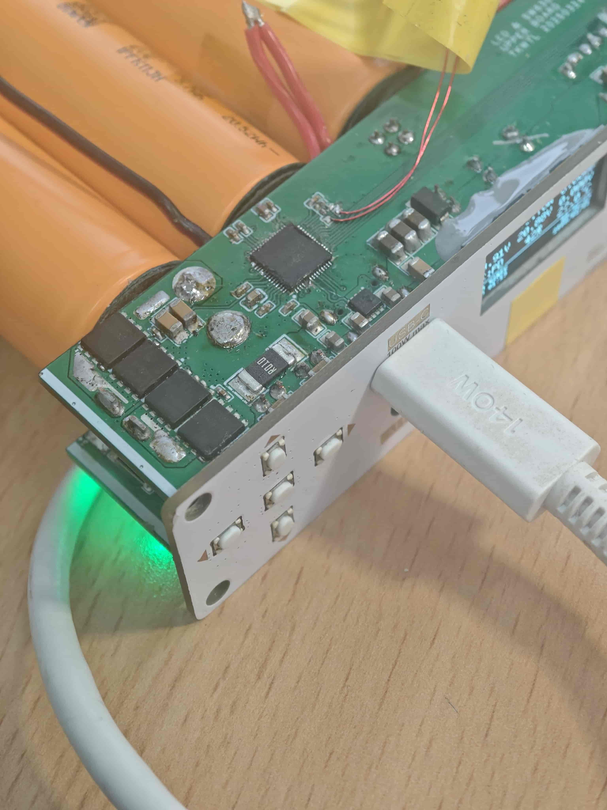

# PB10A 整机测试报告

> 本报告记录作者手中 PB10A 样机的实测结果及后续测试计划，涵盖机械特性、充放电容量与效率、端口输出品质、端口能力、热性能、内部电路行为、低功耗及整机功能与可靠性。**所有实测数据仅适用于该样机及记录的工况，不代表批量产品、通用 SW6306 版本或仓库最新版 PCB 的性能保证。**
>
> 表格约定：`待填` = 已有记录中的信息待补；`待测` = 尚无实测数据；`待放` = 图像待补；`待定` = 判定依据待确认。现行固件配置及建议测试指标均不作为已测结果。

**测试层次与阅读顺序：** 本报告以整机为黑盒，首先评价不拆机即可测得的机械特性、充放能量及循环效率、输出端口纹波、协议与带载能力（§3–§6）；随后通过外壳与内部测点的温升测试（§7）连接外部表现与内部热设计，再评价内部开关波形及器件应力、采样校准、端口至电池端的稳态效率与内部功耗（§8–§10）。最后进行整机功能、保护及长期可靠性验证（§11）。黑盒性能回答“产品对外表现如何”，内部测试回答“设计为何达到该表现，以及是否存在影响可靠性的隐患”。端口纹波与内部开关尖峰是不同测量对象：前者影响负载供电品质，后者主要用于判断器件应力和设计裕量，不能相互替代。

## 1. 测试对象、版本差异与条件

### 1.1 测试对象

| 项目 | 内容 |
|---|---|
| 测试对象 | 作者手中实际组装的单台 PB10A 样机，无独立样机编号 |
| 硬件版本 | 2025 年旧版 PCB，包含主板、SW6306 电源板与面板；局部电路通过飞线实现后续修订 |
| 最新硬件文档 | 飞线所实现的电路修改已在最新 PCB 设计中固化，见 [Hardware](../Hardware/README.md)；本文旧样机数据不等同于新版 PCB 实测结果 |
| 固件版本 | 历史测量未逐项记录固件 commit；后续复测记录实际烧录版本，不能以文档提交号替代 |
| 电池组 | 5S1P，EVE 58E（21700，4.2 V/节，标称 3.6 V / 5.8 Ah） |
| 电池标称能量 | 18.0 V × 5.8 Ah ≈ 104.4 Wh（**计算值**，非实测） |
| 充电输入 | C1，PD 5–20 V，最高 5 A（100 W）；`VCHG` 允许申请 20 V |
| 放电输出 | C1/C2：PD 5–20 V/5 A；A1：A 口快充；内部 A2 用于外部负载计量，附加 A 口为 Aux-A；`POSET` 芯片侧配置上限 105 W（非持续输出认证值） |
| 多口策略 | SW6306 多口同时输出时可能进入双口 5 V 模式，实际电压以实测为准 |
| 环境 | 23 °C（2026-11-25 无外壳 100 W 充电温升实测值）；其余工况按 25 ± 2 °C 控制并记录实际值 |
| 已记录测试日期 | 2026-11-25（温升等原报告记录）；其他截图采集时间以实际记录为准 |

### 1.2 样机特有差异与适用范围

- **SW6306：** 本样机所用 SW6306 与通用版本存在差异，具体芯片版本及全部差异尚未逐项确认。BUS 端检流链路的等效增益存在偏差，导致未经校准的 BUS 电流、功率读数不准确，并可能影响芯片内部依赖 BUS 电流检测的功率调节和限流表现。实际影响范围及硬件动作阈值需由外部仪器验证，不能由读数补偿系数直接推出。
- **PCB：** 样机使用 2025 年旧版 PCB，并以飞线实现局部改动；最新硬件设计已将这些修改固化到 PCB。飞线及新旧走线差异可能影响寄生参数、开关尖峰、纹波、热分布与电磁兼容性，不能假定新版与旧样机完全一致。
- **校准：** BUS、BAT 的实测等效增益及测量边界见 §9.1。软件校准不等于修改 BUS 硬件限流或协议电流档位，亦不证明新 PCB 或其他芯片批次需要同样的补偿。
- **证据归属：** 本文保留原始测量值；不将显示读数自动作为外部参考仪表数据，不对未知校准状态的历史数据实施追溯修正。最新版固件配置单独注明，不用于推定历史测试时的设置。

### 1.3 测试前约定

- **满电**：C1 充电至截止（截止电流 200 mA，`CHGEND_200M`），静置 10 min 后记录开路电压；
- **空电**：原报告采用 2.8 V/节 UVLO（组端 14.0 V）作为历史测试约定；当前固件源码配置为 3.0 V/节（组端 15.0 V），迟滞 0.3 V/节。后续测试按实际烧录版本与实际关断条件记录，不能混用不同截止电压下的容量与效率；需要固定终止电压的工况在表中注明；
- 每次测试前样机与环境同温 ≥ 2 h，测试间隔 ≥ 30 min；
- 能量一律按 Wh 计，容量同时记录 Ah：输入（5–20 V）、输出（5–20 V）与电池（18 V）
  三处的 mAh 不可直接比较或相除。

> 待拍：测试台全景（仪器接线、被测整机、负载与温度探头）。

## 2. 测试仪器与通用方法

### 2.1 测试仪器与测量限制

| 仪器 | 型号 | 用途 | 关键指标（标称） |
|---|---|---|---|
| 数字万用表 | ZOYI ZT219 | 电池/输入电压、电流、温度复核 | 19999 字；DCV 0–1000 V（19.999 mV 起）±(0.5 %+3)；DCA 0–20 A；温度 −20–1000 °C ±(2.5 %+5 字)，配 K 型热电偶 |
| 示波器 | SIGLENT SDS5104X | MOS Vgs/Vds、尖峰、纹波 | 4 通道，1 GHz，5 GSa/s；各节另行注明探头与带宽设置 |
| 电子负载 | Ainuo AN29206 | 恒流放电、瞬态带载 | 交直流电子负载；DC 2–260 V / 0–60 A / 8.4 kW；CC/CR/CP；电压分辨率 100 mV、电流分辨率 10 mA |
| USB 表 | WITRN U3 | 充入/放出容量与能量积分 | 4–24 V / 0–6 A；16 bit ADC；V/I 分辨率 0.00001；按时间积分统计 Ah、Wh |
| 红外热像仪 | UNI-T UTi260B | 无外壳/有外壳表面温度分布、热点定位 | 红外 256×192；−20–550 °C；±2 °C/±2 % 取大值；可见光 640×480 |
| 电源 A | LENOVO C140 | 充电输入源 | 140 W（20 V/7 A）USB-C 适配器 |
| 电源 B | SW3538 自制模块 | 充电输入源（对照/限流工况） | 规格待填 |
| 线缆与夹具 | 待填 | 20 V/5 A 需 5 A E-Marker C-C 线；负载端用短粗线 | 记录线长与线径 |
| 温度复核 | ZT219 + K 型热电偶 | 热像仪读数复核（金属测点必测） | 见上 |

> 本次仪器**未提供校准证书**，不确定度按上表标称精度估计：U3 只给出 16 bit ADC 与
> 0.00001 分辨率、未公布精度指标，AN29206 电流精度 0.1 %+0.2 % 量程；原报告对充放效率给出的粗略估计为 ±2 个百分点。由于 U3 精度、测量参考面及自耗尚未完整核实，该数值不是经过完整不确定度评定的置信区间，仅供本样机测试规划参考，**不宜作为对外认证数据**。

### 2.2 通用测试条件与约定

- 容量与能量一律取仪器**积分值**（充电用 U3、放电用 U3），不用“瞬时读数 × 时长”估算；瞬时功率与稳态变换效率另外测量（§9）；
- 明确测量参考面：电池端、PB10A 端口、USB 表测量位置及负载端不混用；记录 USB 表自耗、线缆压降、仪器接入方式及校准状态，避免重复计入或遗漏损耗；
- 示波器测量：纹波用 **AC 耦合、20 MHz 带宽限制、×10 探头、短地弹簧/极短地线**
  （禁止 10 cm 鳄鱼夹地线）；开关节点浮地测量用差分探头或隔离通道；
- 温度稳定判据：连续 10 min 内最高测点变化 < 2 °C，或按各节规定的时长截止；
- 热像仪记录整幅图像，金属测点（MOS 漏极、电阻焊盘）需贴胶带提高发射率，并用 K 型
  热电偶复核；
- 记录：每组数据留下仪器读数截图/CSV 与时间戳，原始文件按附录 A 命名；
- 单点测量不得写成全工况结论，适用条件与失效边界写在对应小节与 §12。

## 3. 重量与尺寸

**测试条件**

- 电子秤（分辨率 0.1 g，型号待填）、游标卡尺（0.02 mm）；
- 整机称量不含线缆；长×宽×高取外壳最大外形，记录测量基准（是否含按键/接口凸起）；
- 每个尺寸测 3 次取平均。

**测试结果**

| 项目 | 实测 | 设计值 | 差值 | 测量工具 |
|---|---:|---:|---:|---|
| 整机重量（g） | 待测 | 待填 | — | 电子秤 |
| 长 × 宽 × 高（mm） | 待测 | 待填 | — | 卡尺 |
| 电池组重量（g） | 336.2 | — | — | 电子秤 |
| 外壳重量（g） | 144.6 | — | — | 电子秤 |
| 背板重量（g） | 11.9 | — | — | 电子秤 |

**分析**

待填。至少回答：与设计目标的偏差、装配一致性、能量密度（104.4 Wh / 整机重量）。

## 4. 充放电容量与整机效率

### 4.1 充入容量

**测试条件**

- 空电 → 满电，C1 单口输入；C140（20 V/5 A）为主，SW3538 模块做对照；
- 输入链路：适配器 → U3 → C1；充入 Ah/Wh 取 U3 的**积分值**，导出曲线用于复核，
  不用瞬时功率估算；
- 环境按 §1 记录；同一轮充放电之间静置 10 min。

**测试结果**

| 轮次 | 输入源 | 输入电压 (V) | 输入电流 (A) | 时长 (min) | 充入 Ah | 充入 Wh | 终止条件 | 备注 |
|---|---|---:|---:|---:|---:|---:|---|---|
| CH-1 | C140 | 待测 | 待测 | 待测 | 待测 | 待测 | 200 mA 截止 | U3 积分 |
| CH-2 | C140（复测） | 待测 | 待测 | 待测 | 待测 | 待测 | 200 mA 截止 | U3 积分 |
| CH-3 | SW3538 模块 | 待测 | 待测 | 待测 | 待测 | 待测 | 200 mA 截止 | 记录实际功率 |

图：待放（`Images/Testing/charge_curve.png`，U3 上位机曲线）

**分析**

待填。重点核对：

- 输入是否稳定在 20 V/5 A（100 W）；若适配器只给到 15 V 或线缆不是 5 A，输入功率和充电时长可能变化，充入 Wh 的变化方向仍需实测；必须在备注中写明实际协商档位；
- 充入能量受实际可用电池能量、起止条件与充电通路损耗影响。104.4 Wh 为标称计算值，并非本轮实际电池能量；偏离该值时先核查截止条件、输入功率及电池实际容量，不能仅据此判定效率。

### 4.2 放出容量

**测试条件**

- 满电 → 空电，以 C1 单口输出为主（A1 对照）；链路：C1 → U3 → AN29206，负载只提供 CC 拉载与电压监测；
- 放出 Ah/Wh 取 U3 的**积分值**；U3 工作范围 4–24 V / 0–6 A，20 V/5 A 仍在范围内，
  但需注意其插入损耗与压降；
- 20 V/5 A 需 5 A E-Marker 线与 100 W 协议协商；若只协商到 15 V，如实记录为不同工况，不外推至 20 V/5 A；
- 若 U3 不便串入输出侧，则改取负载的积分值，并在备注注明来源（两轮不要混用不同来源）。

**工况**

| 工况 | 端口 | 电压 (V) | 电流 (A) | 功率 (W) | 终止 |
|---|---|---:|---:|---:|---|
| D1 | C1 | 5 | 3 | 15 | UVLO |
| D2 | C1 | 9 | 3 | 27 | UVLO |
| D3 | C1 | 12 | 3 | 36 | UVLO |
| D4 | C1 | 15 | 3 | 45 | UVLO |
| D5 | C1 | 20 | 5 | 100 | UVLO |
| D6 | A1 | 9 | 2 | 18 | UVLO |

**测试结果**

| 工况 | 实测 V/I/P | 时长 (min) | 放出 Ah | 放出 Wh | 终止电压 (V) | 备注 |
|---|---|---|---:|---:|---:|---|
| D1 | 待测 | 待测 | 待测 | 待测 | 待测 | U3 积分 |
| D2 | 待测 | 待测 | 待测 | 待测 | 待测 | U3 积分 |
| D3 | 待测 | 待测 | 待测 | 待测 | 待测 | U3 积分 |
| D4 | 待测 | 待测 | 待测 | 待测 | 待测 | U3 积分 |
| D5 | 待测 | 待测 | 待测 | 待测 | 待测 | U3 积分 |
| D6 | 待测 | 待测 | 待测 | 待测 | 待测 | U3 积分 |

**分析**

待填。重点：100 W 能否持续到 UVLO（是否中途掉功率/降档）、不同档位放出 Wh 的差异、
A1 与 C1 的差异。

### 4.3 整机充放效率

本节采用黑盒测量边界，仅使用外部输入/输出端口的积分能量；电池端的分段稳态效率另见 §9.2。

**定义**

η_round = E_dis / E_chg × 100 %

- E_chg：充电侧 U3 测量参考面处的积分输入能量，包含该参考面之后的充电通路损耗；参考面之前的适配器和线缆损耗不计入；
- E_dis：放电侧 U3 测量参考面处的积分输出能量；USB 表自耗、插入压降及参考面与 PB10A 端口之间的线缆损耗需按实际接法说明；
- 因此 η_round 是**整机充放综合效率**，既不是充电器效率，也不是变换器效率；电池内部
  损耗无法与变换损耗分离。需要分段效率时必须另加电池侧能量测量（本次未做）。
- 对应关系：计划 R-1 为 CH-1 ↔ D5，R-2 为 CH-2 ↔ D1（独立充放循环）。各循环应采用一致的起止电池条件；不将同一充电积分重复用作两个独立循环的分母。实际对应关系按测试记录填写。

**结果**

| 轮次 | E_chg (Wh) | E_dis (Wh) | η_round (%) | 对应放电工况 | 备注 |
|---|---:|---:|---:|---|---|
| R-1 | 待测 | 待测 | 待测 | D5（20 V/5 A） | |
| R-2 | 待测 | 待测 | 待测 | D1（5 V/3 A） | 低压档参考 |

**分析**

待填。写明效率随放电档位的变化、主要损耗来源（线缆、变换器、电池内阻）以及是否达到
设计目标；同时记录仪器、参考面、自耗与重复性，参见 §2.1 的不确定度限制。

## 5. 输出端口纹波

本章仅评价从整机外部端口 VBUS/GND 测得的输出电压纹波，不包含内部半桥中点、辅助电源 LX 等开关节点的尖峰或振铃（见 §8）。

**测试条件**

- 单口加载、其余口空载；分别测 C 口（C1）、A 口（A1）、附加 A 口（Aux-A；并非 SW6306 内部 A2）；
- 计划每口 5 V/3 A（15 W），负载 CC；仅在该端口、线缆及电源级额定能力已确认的前提下执行，若不支持则按实际允许电流测试并记录；
- 示波器：AC 耦合、20 MHz 带宽限制、×10 探头、短地弹簧/极短地线，探头就近接端口
  VBUS 与 GND；
- 每口记录 10 s 内最坏 Vpp、Vrms 与主频。

**结果**

| 端口 | 实测 V (V) | 实测 I (A) | Vpp (mV) | Vrms (mV) | 主频 (kHz) | 图 |
|---|---:|---:|---:|---:|---:|---|
| C1（C 口） | 待测 | 待测 | 待测 | 待测 | 待测 | 待放 |
| A1（A 口） | 待测 | 待测 | 待测 | 待测 | 待测 | 待放 |
| Aux-A（附加 A 口） | 待测 | 待测 | 待测 | 待测 | 待测 | 待放 |

补充（可选）：9/12/15/20 V 档单口纹波，用于对比升压比与纹波的关系。

**分析**

待填。

## 6. 端口能力与输出特性

本章以外部端口为测量边界，验证协议协商、持续带载能力、输出电压及多口切换的实际表现。内部电流检测和端口至电池端的转换损耗另见 §9。

### 6.1 协议、单口与多口能力

| 测试对象 | 工况与观察量 | 结果 |
|---|---|---|
| C1 充电 | PD 固定档、PPS、UFCS 等实际支持协议；记录协商电压电流、实际功率及降档行为 | 待测 |
| C1/C2 放电 | 固定 PDO、PPS/APDO、UFCS 的实际支持档位，5 A 线缆条件，持续功率及降额 | 待测 |
| A1 放电 | 实际支持的 QC/FCP/SCP 等协议、各电压档位与负载 | 待测 |
| Aux-A | 5/9/12 V 等实际支持输出，电压/电流、功率、空载与轻载关断 | 已有波形见 §8.7；稳态能力待测 |
| 多口及插拔 | C/A 同时带载、插拔顺序、协议重协商、5 V 回退、输出中断与功率分配 | 待测 |
| 外部负载 | WLED/Aux-A 与 C/A 端口并用、外部负载启停时各端口是否受影响（A2 内部计量通路的实现与故障定位见固件文档） | 待测 |

配置上限 100 W 输入、105 W 输出不等同于测得的持续功率。应记录端口、协议、线缆 E-Marker、负载和电池电压，分别报告瞬时峰值、可维持功率及热/电流降额；不得超过已确认的器件、线缆或负载能力。

### 6.2 输出调整率与动态响应

在已确认的协议档位和负载能力范围内，测量空载至稳态带载的端口电压变化、负载阶跃时的过冲/跌落及恢复时间；多口插拔时另记录中断与重协商。此处关注外部负载实际承受的电压，不以内部开关节点波形替代。

| 工况 | 空载/带载电压 | 负载阶跃 | 电压过冲/跌落 | 恢复时间 | 结果 |
|---|---|---|---|---|---|
| C1/C2 各支持档位 | 待测 | 待测 | 待测 | 待测 | 待测 |
| A1/Aux-A 各支持档位 | 待测 | 待测 | 待测 | 待测 | 待测 |
| 多口带载与插拔 | 待测 | 待测 | 待测 | 待测 | 待测 |

## 7. 热性能

热性能同时包含两类测量：有外壳时外表面温升属于黑盒使用表现；无外壳时器件和电池测点温升用于分析内部损耗、热设计及可靠性。将两类工况保留在同一章便于对照，但不将裸板温升直接视为成品表面温升。

### 7.1 测试条件

- 已完成：**无外壳、100 W 充电**（C1 20 V/5 A），在电池电压 18 V 与 20 V 两个状态各记
  一组；环境温度 23 °C；
- 待测：100 W 放电（无外壳/有外壳）、有外壳充电；
- 测量：UTi260B 热像仪取整幅热图与测点最高温；金属测点贴胶带或涂黑后复测，并用
  ZT219 + K 型热电偶复核关键点；
- 热像仪设置（发射率、反射温度、距离）需记录；本次未记录，列为 `待填`。

### 7.2 无外壳 · 100 W 充电（环境 23 °C）

图注：无外壳充电测试状态。

#### 7.2.1 电池电压 18 V 时

| 测点 | 位置 | 温度 (°C) | 温升 ΔT (°C) | 备注 |
|---|---|---:|---:|---|
| 输入通路 MOS | AON7544 | 51.0 | 28.0 | |
| BUS 侧检流电阻 | SW6306 采样电阻（10 mΩ） | 55.9 | 32.9 | 本样机采用 10 mΩ；通用版本阻值与增益不可直接套用 |
| Q4 | FSBB 功率管 | 52.8 | 29.8 | |
| 其余 FSBB 管 | 未逐一记录 | 50.3 | 27.3 | |
| 电池保护 MOS | TPH1R403（Q25/Q27 位置） | 40.0 | 17.0 | |
| BM3451 检流电阻 | 保护前端采样电阻 | 40.6 | 17.6 | |
| 电池 | 电芯表面 | 31.0 | 8.0 | |

#### 7.2.2 电池充到 20 V 后

环境温度按同一次测试的 23 °C 计（20 V 状态未单独记录）。

| 测点 | 位置 | 温度 (°C) | 温升 ΔT (°C) | 备注 |
|---|---|---:|---:|---|
| BUS 侧检流电阻 | SW6306 采样电阻（10 mΩ） | 57.2 | 34.2 | 本组最热点 |
| Q4 | FSBB 功率管 | 52.2 | 29.2 | |
| Q1 | FSBB 功率管 | 51.6 | 28.6 | |
| Q2 | FSBB 功率管 | 53.9 | 30.9 | |
| Q5 | FSBB 功率管 | 55.0 | 32.0 | |
| 电池 | 电芯表面 | 40.3 | 17.3 | 充电末尾记录值 |

### 7.3 待测（有外壳 / 放电）

| 测点 | 位置 | 环境 (°C) | 稳定 (°C) | 温升 ΔT (°C) | 备注 |
|---|---|---:|---:|---:|---|
| 外壳正面 | 中心 | 待测 | 待测 | 待测 | 触摸面 |
| 外壳背面 | 中心 | 待测 | 待测 | 待测 | |
| 外壳侧面 | 靠近功率级 | 待测 | 待测 | 待测 | |
| 输出口周围 | C1 口周边外壳 | 待测 | 待测 | 待测 | |
| 内部同点 | 与 7.2 相同测点 | 待测 | 待测 | 待测 | 用于对比壳体热阻 |
| 放电最热点 | 100 W 放电 | 待测 | 待测 | 待测 | 与充电对比 |

**分析**

- 最热点是 BUS 侧 10 mΩ 检流电阻：18 V 时 55.9 °C（ΔT 32.9），20 V 时 57.2 °C
  （ΔT 34.2）。样机采用 10 mΩ 检流电阻；在相同实际电流下，理想电阻的 I²R 损耗为 5 mΩ 电阻的两倍，但不能据此直接推算温升，也不能据此认定通用 SW6306 的适配阻值或直接替换。
- FSBB 管 50.3–55.0 °C（ΔT 27.3–32.0），其中 Q5 最高（55.0 °C）。
- 电池从 31.0 °C 升到 40.3 °C（ΔT 8.0 → 17.3），表面温度低于原报告引用的 45 °C NTC 常温阈值；表面测温与实际 NTC 测点不等价，本次未验证温度保护动作或器件安全裕量。
- 电池保护通路（TPH1R403 40.0 °C、BM3451 检流电阻 40.6 °C）低于本次记录的功率级测点，说明该工况下保护
  通路不是已测最热点；输入通路 MOS（AON7544 51.0 °C）接近 FSBB 水平。
- 测量不确定度：热像仪 ±2 °C/±2 %（取大值），金属表面发射率未校准会**低估**温度；
  K 型热电偶 ±(2.5 %+5 字)。温升绝对值按 ±2–3 °C 看待，横向比较优于绝对值。
- 判定：本次只记录温度，未做限值判定；器件结温/电阻额定温度需按手册换算后判定
  （`待定`）。

## 8. 内部功率电路波形与器件应力

本章测量内部功率电路节点，重点关注 MOS 开关状态、边沿、过冲、振铃及耐压裕量。即使端口纹波较小，内部器件仍可能承受较高瞬态应力；因此内部波形测试是可靠性分析，而不是外部供电品质测试。

### 8.1 测试条件

- 工况：充电含 C1 20 V/5 A（原记录，电池处于 CC 段）及另存的两组充电截图；放电 6 组，条件见 8.2；
- 拓扑与测点：一个半桥开关，另一个半桥上管常通——降压组（输出低于电池，如 20 V →
  18.9 V、16.9 V → 5.2 V）为 **BAT 半桥开关、BUS 上管常通**；升压组（输出高于电池，如
  16.9 V → 20.3 V）为 **BUS 半桥开关、BAT 上管常通**。充电（电池 20 V）时观察到的也是
  BUS 无开关动作、BAT 半桥开关。波形按“实际工作的桥”记录，不固定测某几颗管：
  - BAT 半桥：降压组与充电时为开关桥；升压组上管常通、下管关断；记录上/下管 Vgs、Vds；
  - BUS 半桥：降压组上管常通、下管关断；升压组为开关桥；只记录上管 Vgs 与开关桥 Vds；
  - 电池保护 MOS：TPH1R403 的 Vgs、Vds（充/放电切换与保护动作）；
- 探测：对地参考 Vgs 可用 ×10 无源探头；高侧 Vgs、浮地 Vds 或浮地开关节点须使用适当额定的差分探头或隔离通道，**禁止将接地示波器探头的地夹接到浮地节点**；记录探头型号、接法、带宽与测点；
- 时基：按 300 kHz 开关频率（`DCDC0_F300K`，周期约 3.33 µs）看整体，再放大单次开关沿；
- 记录：f_sw、占空比 D、Vds 平台值、tr/tf、Vgs 米勒平台、死区。

### 8.2 放电波形

测点：开关半桥中点（降压组为 BAT 半桥中点，升压组为 BUS 半桥中点），即下管 Vds。

电池 20 V → 输出 18.9 V/2.6 A。

电池 19.2 V → 输出 15.1 V/5.0 A。

电池 19.5 V → 输出 11.9 V/4.0 A。

电池 16.9 V → 输出 20.3 V/3.0 A。

电池 16.9 V → 输出 5.2 V/3.15 A。

电池 16.2 V → 输出 20.3 V/4.8 A。

### 8.3 开关沿细节（放电）

测点同 8.2（降压组 BAT 半桥中点、升压组 BUS 半桥中点），用于观察过冲与振铃。

电池 16.9 V → 输出 5.2 V/3.15 A（上升沿，上升过激 11.765 %）。

电池 16.9 V → 输出 5.2 V/3.15 A（下降沿）。

电池 15.9 V → 输出 20.3 V/2.98 A（上升沿）。

电池 16.2 V → 输出 20.3 V/2.98 A（下降沿）。

### 8.4 充电波形及开关沿

以下六张截图已存在于仓库，工况按文件名登记。具体测点、探头、输入功率参考面及波形参数仍需补录；尤其 111.2 W 只是截图文件名中的输入功率记录，不能视作已核实的 PB10A 持续输入额定值，也不据此修改 100 W 配置说明。

| 工况（截图标记） | 上升沿 | 下降沿 | 定量参数 |
|---|---|---|---|
| 输入 19.0 V / 43.5 W，电池 17.1 V | [截图](../Images/Testing/充电测试-上升沿细节%20输入19.0V%2043.5W%20电池17.1V.png) | [截图](../Images/Testing/充电测试-下降沿细节%20输入19.0V%2043.5W%20电池17.1V.png) | 待提取 |
| 输入 19.9 V / 111.2 W，电池 18.1 V | [截图](../Images/Testing/充电测试-上升沿细节%20输入19.9V%20111.2W%20电池18.1V.png) | [截图](../Images/Testing/充电测试-下降沿细节%20输入19.9V%20111.2W%20电池18.1V.png) | 待提取 |

### 8.5 开关尖峰与器件应力

| 工况（电池 → 输出） | 上升过激 |
|---|---:|
| 20.0 V → 18.9 V/2.6 A | 11.475 % |
| 19.2 V → 15.1 V/5.0 A | 11.966 % |
| 19.5 V → 11.9 V/4.0 A | 13.445 % |
| 16.9 V → 20.3 V/3.0 A | 18.548 % |
| 16.9 V → 5.2 V/3.15 A | 11.765 % |
| 16.2 V → 20.3 V/4.8 A | 26.613 % |

注：上升过激为示波器自动测量；峰峰值会叠加负向电压，故与过冲百分比不一致。

充电（电池 20 V，100 W）：BAT 半桥中点尖峰 26 V，BUS 半桥无开关动作。

应力评估须补记录绝对峰值、最低电压、过冲定义、探头带宽、振铃频率及器件耐压裕量。旧版 PCB 与飞线可能影响测得波形，新版硬件需复测；不以单次过冲百分比认定耐压合格。

### 8.6 待补开关测量

| 工况 | 器件/测点 | f_sw (kHz) | D (%) | Vds 平台 (V) | Vds 峰值 (V) | tr / tf (ns) | 死区 (ns) | 图 |
|---|---|---:|---:|---:|---:|---|---|---|
| 充电 20 V/5 A | BAT 半桥上管 Vgs | 待测 | 待测 | — | — | — | — | 待放 |
| 充电 20 V/5 A | BAT 半桥上管 Vds | 待测 | 待测 | 待测 | 待测 | 待测 | 待测 | 待放 |
| 充电 20 V/5 A | BAT 半桥下管 Vgs | 待测 | 待测 | — | — | — | — | 待放 |
| 充电 20 V/5 A | BAT 半桥下管 Vds | 待测 | 待测 | 待测 | 待测 | 待测 | 待测 | 待放 |
| 充电 20 V/5 A | BUS 半桥上管 Vgs | — | — | — | — | — | — | 静态（常通） |
| 放电 20 V/5 A（升压段） | BUS 半桥 Vgs/Vds | 待测 | 待测 | 待测 | 待测 | 待测 | 待测 | 待放 |
| 放电 20 V/5 A（升压段） | BAT 半桥上管 Vgs | — | — | — | — | — | — | 静态（常通） |
| 电池保护 MOS 动作 | TPH1R403 Vds | — | — | — | 待测 | 待测 | — | 待放 |

### 8.7 附加 A 口及其他电源开关波形

现有附加 A 口放电截图，工况按文件名登记；不能仅凭文件名判断测点为开关节点还是端口纹波，待原图及测量设置复核；若属于端口纹波则移入 §5。

| 电路 | 已有截图 | 待补测量 |
|---|---|---|
| TPS54302 辅助电源 | [亮屏 LX](../Images/Testing/TPS54302辅助电源LX波形%20亮屏时.png)、[休眠 LX](../Images/Testing/TPS54302辅助电源LX波形%20休眠时.png)、[休眠 LX 放大](../Images/Testing/TPS54302辅助电源LX波形放大%20休眠时.png) | 实际频率、脉冲工作方式、输出纹波、轻载效率与静态功耗（§10） |
| WLED 驱动 | [1 档 LX](../Images/Testing/WLED%20LX开关波形%201档.png)、[16 档 LX](../Images/Testing/WLED%20LX开关波形%2016档.png) | 开关频率、占空/脉冲模式、输入/输出功率及温升 |

截图均为已有文件，尚未在本次文档更新中重新提取仪器数值。

## 9. 内部采样校准与稳态变换效率

本章需要内部电池端或采样链路数据，主要用于验证硬件设计与控制精度。它与 §4 的黑盒循环效率、§6 的端口带载表现互补。

### 9.1 电流检测及补偿

本节记录作者样机的已知校准依据与现行固件配置。校准数据来自 [SW6306 驱动说明](../Firmware/BSP/SW6306/README.md)（本次文档更新所依据的源码版本为 `0438452`），不代表所有历史测试使用相同固件。

| 电流域 | 参考值 | SW6306 未补偿读数 | 增益依据 | 当前整数补偿 |
|---|---:|---:|---|---|
| BUS（放电） | 4.970 A（U3 显示）+ 约 0.015 A（U3 自耗） | 4.460 A | 4.985 / 4.460 ≈ 1.11771 | 997 / 892 |
| BAT（充电） | 5.952 A（万用表） | 5.990 A | 5.952 / 5.990 ≈ 0.99366 | 159 / 160（两点综合） |
| BAT（放电） | 1.292 A（万用表） | 1.300 A | 1.292 / 1.300 ≈ 0.99385 | 159 / 160（两点综合） |

BUS 校准点的未补偿读数相对估计参考电流约低 10.5%；补偿相对于原读数约增加 11.8%。两者基准不同，不能混称为同一种百分比误差。U3 约 15 mA 自耗是该工况下的估计，不应无条件应用于所有电压、方向或积分容量记录；BAT 万用表参考值不另加 U3 自耗。

固件整数模式在读出电流时使用上述增益。BUS 补偿只修正软件电流读数及其派生显示，不调整 BUS 内部硬件限流或 PD/PPS/UFCS 电流档位；BAT 增益同时用于电流、限流换算与库仑计能量。增益包含芯片与采样链路的综合误差，不代表独立测得的采样电阻实际阻值。由于样机 SW6306 与通用版本存在差异，复刻时不得无条件套用此增益。

**待补校准验证：** 在充电、放电分别选取低、中、高电流点，记录参考仪表的测量参考面、零点、原始读数、补偿后读数、绝对/相对误差及温度；零电流不计算相对误差。电压也分别在 BUS/BAT 端复核。另测实际输出限流与恒功率调节，判断采样偏差对硬件控制的影响；不要只检查屏幕显示。

| 工况 | 参考 V/I | 原始 V/I | 补偿后 V/I | 残差 | 备注 |
|---|---|---|---|---|---|
| BUS 充电低/中/高电流 | 待测 | 待测 | 待测 | 待测 | 记录仪表参考面 |
| BUS 放电低/中/高电流 | 待测 | 待测 | 待测 | 待测 | 含 U3 自耗复核 |
| BAT 充电/放电多点 | 待测 | 待测 | 待测 | 待测 | 万用表参考 |
| 新版 PCB 或通用芯片对照 | 待测 | 待测 | 待测 | 待测 | 如有条件进行 |

### 9.2 稳态变换效率

与 §4.3 的整机充放循环效率不同，本节在同一稳定工况同步测量端口与电池端功率：

- 充电侧：η_chg = P_BAT / P_IN × 100 %；
- 放电侧：η_dis = P_OUT / P_BAT × 100 %。
- 各功率采用实际测量参考面上的电压、电流，按能量流向取正值；明确显示、WLED、FM 及其他端口状态。上述是电池端至端口的系统级稳态效率，不自动等同于单颗变换器效率。USB 表自耗与线损按测量边界处理。

| 工况 | 端口 V/I/P | 电池 V/I/P | 效率 | 备注 |
|---|---|---|---|---|
| C1 充电，不同电池电压及功率 | 待测 | 待测 | 待测 | 记录 CC/CV |
| C1 放电 5/9/12/15/20 V | 待测 | 待测 | 待测 | 各档轻载至额定能力 |
| A1 / Aux-A 放电 | 待测 | 待测 | 待测 | 分端口记录 |
| 多口稳态带载 | 待测 | 待测 | 待测 | 瞬态响应见 §6.2 |

待补效率曲线及功率限制与电池电压的关系；外部输出调整率与阶跃响应见 §6.2。若计算结果大于 100%，先检查同步性、测量边界、自耗和增益，不能直接作为有效效率。

## 10. 静态功耗与低功耗特性

### 10.1 电池端功耗

**测量边界及约定**

- 2026-11-28 新增实测：电池电压约 **16 V**，记录整机输入电流；电流与功率均按电池侧参考面描述。功率采用 `P = U × I` 按 16 V 计算，属于**计算值**，并非独立功率计测量结果。
- 用户报告的状态为“亮屏”和“休眠”；固件设计的深度休眠模式为 STOP1，但此次没有同步提供 MCU 模式波形，故下表“休眠”不等于独立验证过 STOP1 进入、保持和唤醒全过程。
- 尚未记录本轮仪器及量程、环境温度、完整固件 commit、音量绝对档位、各端口连接状态、WLED 状态及每组稳态持续时间，均应在后续复测时补齐；本次仅记录已提供的条件与观测，不补造测试参数。

**2026-11-28 实测：16 V 电池端**

| 工况 | 电池电压 (V) | 实测电流 | 电池侧功率（计算） | 时间/现象 | 备注 |
|---|---:|---:|---:|---|---|
| 亮屏，RDA5807 关闭 | 16 | 4.28–6.27 mA | 68.48–100.32 mW | OLED 点亮范围越大，电流越大 | 未统一画面；不能用此范围直接判定 MCU 功耗变化 |
| 亮屏，RDA5807 开启 | 16 | 10.08 mA | 161.28 mW | 音量变化仅引起约 0.05 mA 量级的电流变化 | 约对应电池侧 0.8 mW；屏幕图案、音量档位待补 |
| 休眠，RDA5807 开启（初期） | 16 | 5.26–5.66 mA | 84.16–90.56 mW | 呈两档周期性波动；约 30 s 后转为稳定值 | 两档切换周期未量化，不视为 30 s 周期唤醒 |
| 休眠，RDA5807 开启（稳定） | 16 | **5.266 mA** | **84.256 mW** | 入睡后约 30 s 达到稳定状态 | RDA5807 保持开启 |
| 休眠，RDA5807 关闭 | 16 | **0.459 mA**（459 μA） | **7.344 mW** | 稳态值；记录时长待补 | 整机纯休眠基线，未分离 SW6306、MCU 及辅助电源损耗 |
| 普通 Sleep / 调度空闲 | 待测 | 待测 | 待测 | 待测 | 区分 RUN 与 MCU Sleep 的实际占空 |
| RTC 周期唤醒与巡检平均功耗 | 待测 | 待测 | 待测 | 待测 | 需要覆盖完整巡检周期及唤醒电荷积分 |
| WLED 各代表性档位 | 待测 | 待测 | 待测 | 待测 | 记录对应档位、外部负载及温度 |

**历史工况对照（此前提供的测试值）**

此前以 **15 V VSYS 供电、未连接电池**测得以下整机输入电流。历史数据仅用于观察量级，不与 16 V 电池端测量混作同一参考面；历史画面、仪器和环境条件不完整，不能据此认定固件优化导致功耗升降。

| 工况 | 历史供电条件 | 历史电流 | 输入功率（按 15 V 计算） | 与本轮的可比性 |
|---|---|---:|---:|---|
| 亮屏，RDA5807 关闭 | 15 V VSYS | 3.93 mA | 58.95 mW | 亮屏内容未统一 |
| 亮屏，RDA5807 开启 | 15 V VSYS | 9.40 mA | 141.00 mW | 显示内容、音量和供电条件均可能不同 |
| 休眠，RDA5807 开启 | 15 V VSYS | 5.90 mA | 88.50 mW | 本轮稳定值为 84.256 mW；供电参考面不同 |
| 休眠，RDA5807 关闭 | 15 V VSYS | 0.520 mA | 7.80 mW | 本轮为 7.344 mW；供电参考面不同 |

**计算与初步分析（非新增实测）**

- 同为 16 V、休眠状态，开启 RDA5807 相对关闭时的整机增量为 `5.266 − 0.459 = 4.807` mA，折合 `16 × 4.807 = 76.912` mW。该值包含收音机及其供电转换、参考时钟等新增系统损耗，**不是单独测得的 RDA5807 芯片电流或功率**。
- 亮屏且 FM 关闭时，随 OLED 点亮范围变化的电流跨度为 `6.27 − 4.28 = 1.99` mA，折合 31.84 mW；尚不能将差额完全归于 OLED 发光本身，因为显示内容及前台执行负载未完全固定。
- 休眠开 FM 初期电流两档相差 0.40 mA，折合约 6.4 mW；约 30 s 后稳定不等于固件每 30 s 唤醒一次。当前 FM 后台电池巡检的 RTC 计划周期为 **30 min**，本次未测量巡检瞬态及长期积分平均值。
- 若**仅为比较**而假设在 16 V 恒定运行 24 h，则纯休眠消耗约 `0.459 × 24 = 11.016` mAh（0.1763 Wh），FM 持续开启休眠消耗约 `5.266 × 24 = 126.384` mAh（2.0221 Wh）。这些是恒流/恒压外推值，不是实测的全天耗电、满电续航或长期存放寿命。真实续航受电池电压变化、可用容量、截止阈值、自放电和 RTC 巡检影响。
- 未来复测建议使用固定 OLED 全黑/半亮/全亮画面，固定 FM 电台、音量和耳机负载，在相同电池电压及测量参考面下分别记录稳态电流，并跨越完整的 30 min RTC 后台巡检周期积分。辅助电源亮屏/休眠 LX 截图见 §8.7；波形本身不等于整机功耗数据。

### 10.2 睡眠及唤醒

| 测试项 | 观察量 | 结果 |
|---|---|---|
| 空闲自动休眠、手动休眠 | 进入条件、延迟、外设挂起、休眠电流 | 已有休眠电流实测（§10.1）；进入条件与响应时间待测 |
| 按键、插拔、共享 IRQ、RTC 闹钟唤醒 | 唤醒成功率、响应时长、误唤醒及状态恢复 | 待测 |
| FM 后台巡检 | 是否保持 MCO/音频、周期及电池检查、OLED 是否误亮 | 已有 FM 开启时休眠电流；完整 30 min RTC 巡检仍待测 |
| 反复休眠唤醒 | 复位原因、WWDG、I2C 锁、界面及设置保留 | 待测 |

现行固件采用 STOP1、FM 后台每 30 min RTC 电池巡检等策略，具体配置见 [固件总览](../Firmware/README.md)。§10.1 的电流读数只能说明相应整机工况的电源消耗，不能替代 STOP1 时钟保持、RTC 唤醒可靠性及完整周期平均功耗的验证。

## 11. 保护、功能与可靠性验证

以下为新增验收与回归矩阵。固件配置和预期行为不是已通过的测试结果；保护测试仅在确认器件、接线、限流、温度监测与安全隔离条件后开展，不通过直接短接真实电池等方式人为制造危险故障。

### 11.1 电源及温度保护

| 测试项 | 现行源码配置 / 预期行为 | 测量与记录 | 结果 |
|---|---|---|---|
| SW6306 放电 UVLO | 3.0 V/节，5S 组端 15.0 V，迟滞 0.3 V/节；E01 为 WARNING，保留记录与通知，不触发故障音 | 实际触发/恢复电压、持续时间、关断与通知 | 待测 |
| BAT 电流限制 | 充电 6 A、放电 10 A 目标，按 BAT 校准换算寄存器 | 参考仪表实测限流点、降额与电压 | 待测 |
| BUS 过载、短路、过压 | 芯片硬件保护；BUS 软件增益不改变硬件阈值 | 受控限流台架验证动作、恢复及历史记录 | 待测 |
| NTC 温度保护 | 当前放电 NTC 配置 −10～60 °C；外部负载过热停止及恢复阈值见源码 | 实测触发/恢复、热滞后、实际 NTC 温度 | 待测 |
| Aux-A 欠压/低电流 | 软件检测输出 ≤2 V 时关断；默认低电流阈值 50 mA、持续 60 s | 稳态/瞬态动作、空载误关断、恢复 | 待测 |
| Aux-A/WLED 电池保护 | 当前外部负载截止阈值 15.0 V，另有容量 0% 等条件 | 动作电压、负载关闭、再次启动条件 | 待测 |
| Radio 应急电量保护 | 当前独立电压阈值低于 14.5 V 关闭，≥15.0 V 解除低电压锁定 | 正常运行与后台巡检下的动作及恢复 | 待测 |
| 电池保护板 | 独立于软件，按实际 BM3451 配置及电芯条件 | 经安全验证的保护动作、恢复条件 | 待测 |

参数来源：[SW6306 驱动](../Firmware/BSP/SW6306/sw6306.c)、[功率算法](../Firmware/APP/algorithm/power_algo.h)、[FM 算法](../Firmware/APP/algorithm/radio_algo.c)、[应用说明](../Firmware/APP/README.md)。原历史报告使用的 14.0 V 放电截止与当前配置不同，见 §1.3。

### 11.2 时钟、通信与应用功能

本节结合内部时钟/总线波形与外部可观察的功能行为，分别记录设计实现证据及整机功能验收结果。

| 测试项 | 现有证据 / 待验收指标 | 结果 |
|---|---|---|
| LSE / FM 参考时钟 | [32.768 kHz 参考时钟截图](../Images/Testing/RDA5807%20F32K输入.png)；补测频率误差、STOP1 连续性、不同温度下频偏 | 已有截图，定量分析待补 |
| I2C | [SCL](../Images/Testing/通信波形-SCL.png)、[SCL 放大](../Images/Testing/通信波形-SCL放大.png)、[SDA](../Images/Testing/通信波形-SDA.png)、[SDA 放大](../Images/Testing/通信波形-SDA放大.png)；补测实际速率、上升沿、ACK 及总线恢复 | 已有截图，定量分析待补 |
| SPI | [SCK](../Images/Testing/通信波形-SPI%20SCK.png)、[SCK 放大](../Images/Testing/通信波形-SPI%20SCK放大.png)、[MOSI](../Images/Testing/通信波形-SPI%20MOSI.png)、[MOSI 放大](../Images/Testing/通信波形-SPI%20MOSI放大.png)；补测时序与显示完整性 | 已有截图，定量分析待补 |
| FM | 双向搜台重复性、预设扫描、相邻频道判定、单/双声道、后台播放及音质 | 待测 |
| RTC / 闹钟 | 原始频偏、平滑校准后走时误差、双闹钟与周期唤醒 | 待测 |
| 加速度计、磁力计、气压计 | 重复性、校准前后偏差、水平/方向/高度读数及环境影响 | 待测 |
| 显示、按键、游戏与工具 | 关键操作、方向映射、暂停/恢复、自动休眠、提示音 | 待测 |
| 通知与故障历史 | E/N 编号、优先级、去重、清除及故障音 | 待测 |

已有截图不等于通过通信时序或 EMC 判定。历史固件调试证据见 [Firmware/Debug](../Firmware/Debug/README.md)，不重复写入本报告。

### 11.3 长期运行与故障恢复

建议按连续 24 h、混合使用 72 h、长期运行（例如 7 d）逐步积累记录。时长是计划而非已完成的试验。固件或硬件改版后重复关键工况。

| 测试项 | 记录指标 | 结果 |
|---|---|---|
| 常规运行与多口/功能混合使用 | 运行时长、非预期复位、卡死、输出异常 | 待测 |
| 反复 STOP1 / 唤醒 | 次数、失败率、功耗、设置及会话状态 | 待测 |
| I2C 受控异常与恢复 | 恢复尝试/失败计数、恢复时延、其他设备是否继续工作 | 待测 |
| WWDG 调度监控 | 受控故障注入、复位原因、最大调度轮时长、NOINIT 现场、STOP1 误复位 | 待测 |
| 容量学习、EFC 与复位恢复 | 学习触发、能量计数、复位前后保留数据及一致性 | 待测 |
| 高低温与有外壳持续负载 | 温升、降额、输出稳定及保护动作 | 待测 |

机械强度、跌落、绝缘、耐压、EMC 等需要专门的条件与依据，当前不作符合标准或认证的结论。

## 12. 结论与遗留

| 项目 | 结果 | 判定 |
|---|---|---|
| 重量 / 尺寸 | 部分完成：电池组 336.2 g、外壳 144.6 g、背板 11.9 g；整机重量与尺寸待测 | 待定 |
| 充入/放出容量与整机充放效率 | 待测（§4） | 待定 |
| 端口纹波（C1/A1/Aux-A） | 待测（§5） | 待定 |
| 协议、多口、输出调整率 | 待测（§6） | 待定 |
| 无外壳温升（100 W 充电） | 已完成：最热点 57.2 °C（BUS 侧 10 mΩ 检流电阻），电池 40.3 °C | 未判定 |
| 有外壳温升 / 放电温升 | 待测 | 待定 |
| 充放电 MOS 波形 | 部分完成：充电（电池 20 V）BUS 半桥静态、BAT 半桥开关；放电 6 组波形见 §8.2、边沿细节见 §8.3；充电及 Aux-A 截图见 §8.4/8.7，参数待提取 | 待定 |
| 尖峰 | 部分完成：充电 BAT 半桥 26 V；放电 6 组上升过激 11.475–26.613 % | 未判定 |
| 电流采样校准 | 已记录本样机 BUS/BAT 校准依据及现行补偿配置，多点残差及控制影响待验证（§9.1） | 部分完成 |
| 端口至电池端稳态效率 | 待测（§9.2） | 待定 |
| 静态功耗与休眠唤醒 | 已补充 16 V 电池端亮屏及 FM 开/关休眠电流实测、15 V VSYS 历史对照与计算分析（§10）；完整 RTC 巡检、唤醒统计仍待测 | 部分完成 |
| 保护、应用及长期可靠性 | 已建立验收矩阵；部分通信和参考时钟截图已归档（§11） | 待定 |

**失效边界（本报告结论不覆盖）**

- 数据仅针对作者手中使用 2025 年旧版 PCB、局部飞线及非通用版本 SW6306 的样机；未对新版 PCB、芯片批次、电芯差异与循环衰减作对照验证；
- BUS 检流链路增益偏差和校准状态可能影响显示数据、控制表现及历史工况归属；不能将软件补偿后的结果直接外推至其他样机；
- 温升目前只有无外壳 100 W 充电的两组记录，没有外壳数据；
- 已明确记录的温升环境为 23 °C；其他截图的环境条件待补，未做系统性低温/高温、海拔、湿热验证；
- 现有高功率工况未覆盖 6–8 h 持续负载及长期老化，不能据此确定持续功率；
- 整机充放效率与稳态端口/电池端效率需分别测量；当前容量与效率表仍待填，不能据此得出效率结论；
- 未做 PD/UFCS/QC 协议兼容性、保护动作（过流/短路/过温）与安全项（绝缘、耐压、跌落）。

## 附录 A 原始数据与截图

原始数据（仪器 CSV、示波器截图、热像仪图片）放 `Docs/Test_Data/`
（首次保存时创建），命名 `用途_工况`。下列为约定文件名，当前不表示已存在相应 CSV 或热像原始文件：

| 文件 | 内容 | 章节 |
|---|---|---|
| `charge_C140.csv` | U3 充电积分记录（V/I/Wh/Ah） | §4.1 |
| `charge_SW3538.csv` | U3 充电积分记录（对照） | §4.1 |
| `discharge_20V5A.csv` | U3 放电积分记录 | §4.2 |
| `thermal_nocase_charge_18V.csv` | 无外壳充电温升（电池 18 V） | §7.2.1 |
| `thermal_nocase_charge_20V.csv` | 无外壳充电温升（电池 20 V） | §7.2.2 |
| `thermal_nocase_charge.jpg` | UTi260B 热像图（整幅） | §7.2 |
| `mos_charge_20V5A.png` | 充电 MOS 波形 | §8 |
| `mos_discharge_20V5A.png` | 放电 MOS 波形 | §8 |
| `ripple_C1.csv` / `ripple_A1.csv` / `ripple_AuxA.csv` | 端口纹波记录（单口加载） | §5 |

公开展示用的截图另存 `Images/Testing/`；图片只作为工况记录，不单独作为效率、额定功率
或安全裕量的证据。当前已有的充放电、Aux-A、辅助电源、WLED、FM 参考时钟及通信截图均在 [Images/Testing](../Images/Testing/) 中，按 §7、§8、§11 的相应工况引用。新增原始数据应注明采集时间、仪器配置和对应固件版本。

## 附录 B 填写约定

- 所有 `待测` 替换为实测值，并注明条件（输入、负载、环境温度）；
- 每节保留“测试条件 / 测试结果 / 分析”结构，便于固件升级后复测复用；
- 数值保留：电压/电流 3 位有效数字，能量 0.1 Wh，效率 0.1 个百分点，温度 0.1 °C；
- 单点测量不得写成全工况结论。
