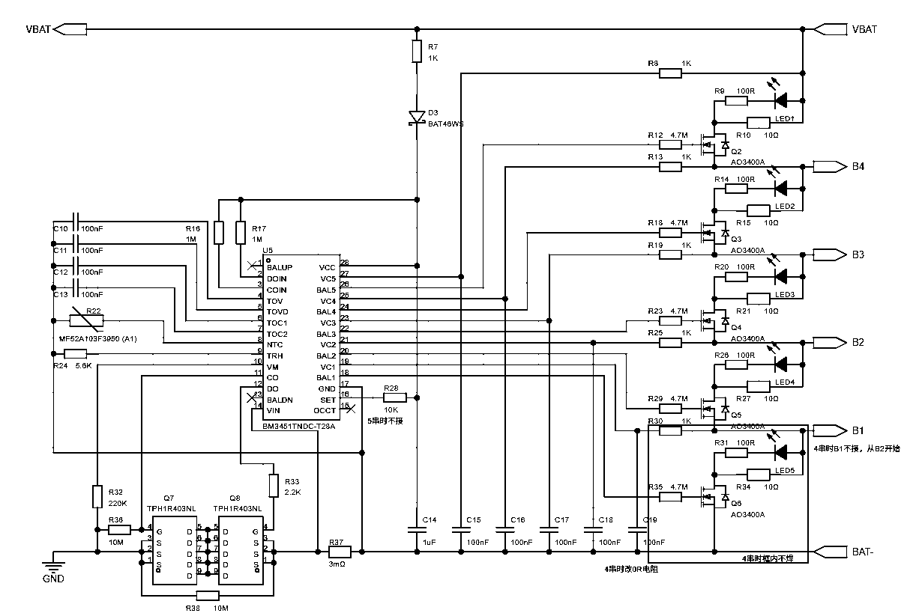
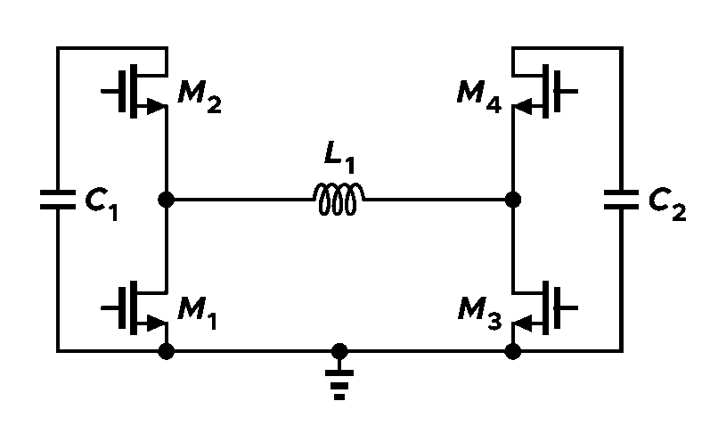
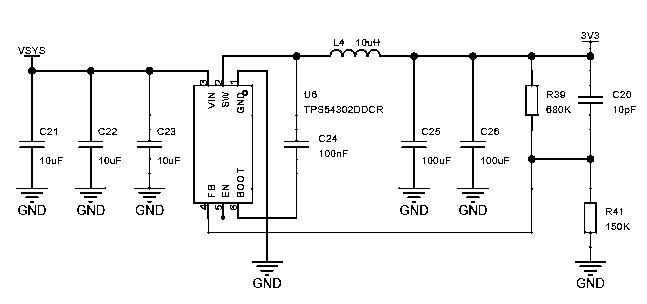
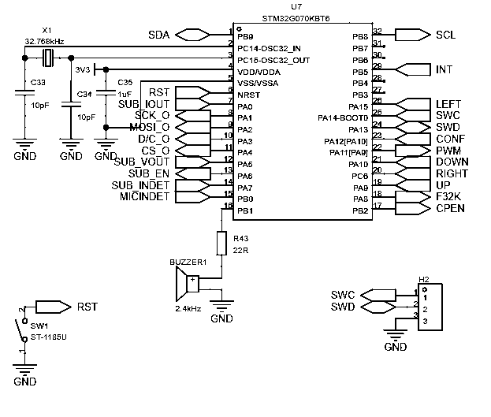
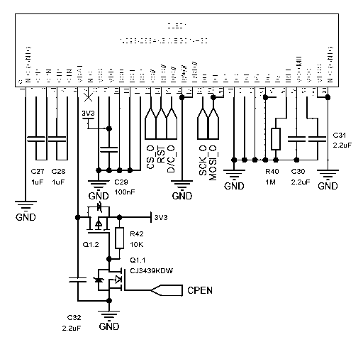
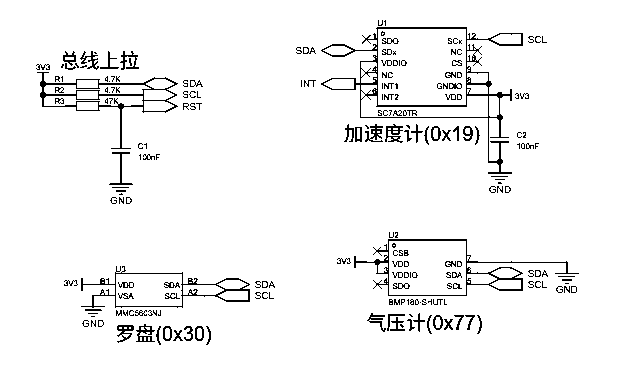
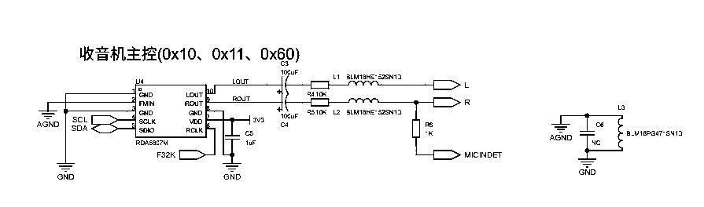
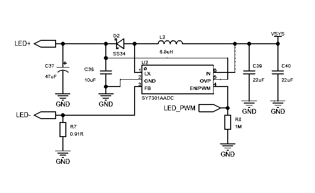

# PB10A 硬件架构与模块解读

> **文档范围**：基于 [主板原理图](Preview/SCH_%E4%B8%BB%E6%9D%BF.pdf)、[SW6306 板原理图](Preview/SCH_SW6306%E6%9D%BF.pdf)、[主板网表](Preview/Netlist_%E4%B8%BB%E6%9D%BF.tel)、[功率板网表](Preview/Netlist_SW6306%E6%9D%BF.tel)、BOM 与作者提供的局部原理图截图，解释当前硬件的供电、通信、控制及保护路径。测试成绩以 [整机测试报告](../Docs/Test_Report.md) 为准，设计复盘和下一代候选方案见 [设计复盘](../Docs/Design_Review.md)。
>
> **版本边界**：历史实测对象为 2025 年旧版 PCB（包含局部飞线），这里的 U/Q/R/C 编号以仓库现版网表及本次局部图为主。**实物改件（例如 BUS 检流从 5 mΩ 改至 10 mΩ）不一定反映在现版 BOM 中**。局部原理图整理为高对比度图像，元件连线和参数仍应以可编辑原理图为最终依据；图像不是独立设计源文件。

## 1. 整机结构与分板

PB10A 的核心由 **5S1P EVE 58E 电池组、主板、SW6306 功率板及面板 OLED** 组成。SW6306 将电池与主 Type-C / USB-A1 之间进行双向升降压；主板同时提供 Aux-A 独立降压输出、3V3 逻辑电源、BM3451 电芯保护、传感器、FM 与控制接口；功率板还包含 WLED 照明升压驱动。

| 功能层 | 主要部件 | 设计取舍 |
|---|---|---|
| 储能 | 5S1P EVE 58E，18 V/5.7 Ah/102.6 Wh 标称 | 提高母线电压；容量和单体电压不能与 5S 的倍数关系混淆 |
| 电池保护 | BM3451TNDC-T28A、Q7/Q8、R37 | 各节监测，电池负极侧双 MOS 物理保护 |
| 主功率 | SW6306V、四开关 FSBB、端口 MOS | 升降压/充电协议集成，但主端口共用输出母线 |
| 第二输出 | TPS54302 U9、IP2161、INA199/R44 | Aux-A 有独立降压和快充协议，不能反向充电 |
| 控制/传感 | STM32G070、I2C 器件、OLED、FM | 统一 UI/状态机与低功耗管理，不替代硬件安全保护 |

## 2. 电源树（Power Tree）

以下为**供电与回流路径的功能图**，不是把所有保护器件都串在电池正极的原理图。网表中 **VBAT 通过 R11（BOM 为 5 mΩ）连至 VSYS**；BM3451 的 Q7/Q8 位于电池负极 BAT− 与系统 GND 之间。这样区分了电源正极分配、总电流检测与负极保护开断。

~~~mermaid
flowchart TD
    Pack["5S1P EVE 58E 18 V / 5.7 Ah / 102.6 Wh 标称"]
    Pack --> P["VBAT 电池正端"]
    Pack --> N["BAT− 电芯负端"]
    N --> Q["BM3451 驱动 Q7/Q8 负极双 MOS 保护"]
    Q --> G["GND 系统回流"]
    P --> SW["SW6306 功率板 双向 FSBB 主功率级"]
    SW <-->|"充电 / 放电"| BUS["VOUTA 共享主 BUS"]
    BUS --> C["Type-C 主端口 GATEC / Q3"]
    BUS --> A["USB-A1 主端口 GATEA / Q6"]
    P --> RS["R11 5 mΩ 电池正端检流 BOM 设计值"]
    RS --> VS["VSYS 辅助电源母线"]
    VS --> D33["U6 TPS54302 3V3 降压"]
    D33 --> LOG["MCU / 传感器 / RDA5807 OLED 逻辑与检测电路"]
    VS --> DA["U9 TPS54302 Aux-A 可调降压"]
    DA --> IS["R44 10 mΩ + U10 INA199 输出电流检测"]
    IS --> USB["Aux-A USB-A 输出 U8 IP2161 协议"]
    VS --> LED["SW6306 板 U2 SY7301A WLED 升压恒流"]
    LED --> LAMP["LED+ / LED− 照明负载"]
    P -. "电芯采样与保护" .-> Q
~~~

**读图重点：** SW6306 的大功率电池侧、VSYS 辅助支路和 BM3451 保护回路不是一条单纯的正极串联链；任何功率路径最终仍须经受 Q7/Q8 的负极保护约束。3V3 是逻辑电源，Aux-A 和 WLED 则各有独立的功率变换器。主 C/A 口**多口同时输出统一进入 5 V 模式**，不适用于独立 Aux-A 的电压设定。

## 3. 电池保护、电量指示和结构

### 3.1 电芯与保护采样

- EVE 58E 单节**标称** 3.6 V、5.7 Ah、20.52 Wh；5S1P 组端标称 18.0 V、5.7 Ah、**102.6 Wh**。串联提高电压，不提高 Ah 容量。
- 主板 **U5 BM3451TNDC-T28A** 通过 VC1–VC5 电芯分压采样与外部阻容实现多节保护；**R22 10 kΩ NTC** 输入用于温度保护。
- **Q7/Q8 = TPH1R403NL**，构成充放电双向断开用保护 MOS；**R37 = 3 mΩ**，为相关电流检测电阻。注意保护位置在负极通路，不是把整组电池正极经 BM3451 芯片输出。
- **LED1–LED5、Q2–Q6 AO3400A** 为电量指示链路；其指示不等于可计费式高精度库仑计测量。

曾在约 14.2 V 组端观察到电池保护断开，与某节进入过放区间相容；缺少每节电压及 DO/CO 记录，不能据此证明具体动作来源。正常放电应由 SW6306 的提前欠压策略截止，BM3451 保留独立兜底保护。

### 3.2 外壳与密度

成品铝型材外壳实测**长 × 宽 × 高 = 104.1 × 121.5 × 29.0 mm**，对应包络体积约 0.3668 L；用标称 102.6 Wh 除以包络体积约为 **280 Wh/L**。仅代表**几何包络指标**，不代表实际可用能量密度或已经验证的长期热性能。

## 4. SW6306 四开关双向 Buck-Boost 主通路

### 4.1 FSBB 拓扑及工作区间

左、右半桥通过中间的储能电感相连，各半桥包含高侧和低侧 MOS。电感两侧开关的占空比由控制器按电压、电流及功率方向调节：在输出端电压**低于**电池时工作于降压区间，在输出端电压**高于**电池时进入升压区间。输入充电时功率方向反转。图片里的 M1–M4 仅用于原理解释，**不等同于现版功率板的 Q1–Q6 器件编号**。

### 4.2 实际功率板与测量入口

| 功能 | 当前功率板 BOM/网表 | 验证重点 |
|---|---|---|
| 控制芯片 | U1 SW6306V | PD/QC/UFCS、充放电状态、保护及电流检测 |
| 主功率 MOS | Q1/Q2/Q4/Q5 BSC0906NS | 栅极驱动、Vgs/Vds、Rds(on)、开关损耗 |
| 主电感 | L1 4.7 µH | 饱和电流、纹波、温升 |
| BUS 检流 | R1 5 mΩ（BOM） | 旧实测样机曾更换 10 mΩ，须记录实装阻值 |
| 主 Type-C | Q3 AON7520，GATEC | 通路导通、短路关断、角色协商 |
| 主 USB-A1 | Q6 AON7544，GATEA | 通路导通、短路保护、输入输出状态 |

对于**充电降压、放电升压、放电降压**，半桥驱动相位及自举要求并不相同。后续应在实际负载下独立测量开关节点、MOS 栅源电压和自举电压，而不能由某一种充电模式正常工作就排除另一模式的局部驱动异常。

**记录边界：** 图片文件名为测试时标注的工况，瞬时充电功率不是电池净吸收功率；这些单次测试也不是全放电区间持续功率、效率或可靠性的保证。主通路多口共享 BUS，多个主端口同时输出时**统一进入 5 V 模式**。

## 5. 主板 3V3 辅助供电：U6 TPS54302

主板 **U6 TPS54302DDCR** 从 VSYS 降压至 **3V3**，配合 **L4 10 µH**、输入去耦 C21–C23 和输出 C25/C26。反馈电阻 **R39 = 680 kΩ、R41 = 150 kΩ**，与芯片参考电压一起设定稳态输出。C20 为反馈前馈电容，C24 为自举电容；具体静态偏差还应考虑电阻精度、FB 基准及开关纹波。

此电源给 STM32G070、RDA5807、I2C 传感器、OLED 逻辑及部分小信号输入网络供电。**3V3 的总输入功耗不等于 MCU 单颗芯片的功耗**，主电源控制、显示、射频及各路静态损耗应分项测量。

上述为开关节点波形证据，不足以直接推导低负载效率。

## 6. 主控、复位、时钟、调试与蜂鸣器

**U7 STM32G070KBT6** 统一运行界面、传感器算法、SW6306 状态机、Aux-A/WLED 控制和功耗管理。**X1 = 32.768 kHz** 配合 C33/C34 为 LSE 时钟；**SW1** 是硬件复位按键；**H2** 引出 SWD 调试接口；**BUZZER1** 由 MCU 经 R43 驱动。

- I2C1：PB9（SDA）、PB8（SCL）；共享 SW6306 和其他 I2C 外设。
- 主板 SPI OLED：CS_O、D/C_O、SCK_O、MOSI_O、RST。
- 交互：LEFT/RIGHT/UP/DOWN/CONF 五键输入，BUZZER1 提示。
- Aux-A：SUB_EN、SUB_VOUT、SUB_IOUT、SUB_INDET；WLED：PWM/LED_PWM。
- 收音机参考信号：F32K；显示供电控制：CPEN。
- INT 为共享的低有效中断输入，不能把一次 IRQ 自动认定为某一特定传感器事件。

正常运行时 MCU 应用层通过异步 I2C、ADC 和低功耗状态机管理这些模块；一旦 MCU 停止运行，BM3451 仍承担独立电池安全保护责任。

## 7. OLED 显示与供电控制

**OLED1 = N096-2864KSWEG01-H30**，MCU 使用 SPI 风格串行信号 **CS_O、SCK_O、MOSI_O、D/C_O、RST** 进行控制。**Q1 = CJ3439KDW**，由 **CPEN** 配合外围电容实现 OLED 的电源/电荷泵控制；C27/C28/C29、C30/C31/C32 分别服务逻辑、显示驱动和内部电荷泵的外围滤波。

**不要把 CPEN 等同于切断全部 3V3**：网表显示 OLED 逻辑电源与显示驱动电源存在不同引脚和支路。需要结合屏幕芯片的上/下电顺序，确认真正关闭的电源域、GPIO 回灌路径和休眠剩余电流。

本样机在 16 V 电池端亮屏电流 4.28–6.27 mA，随点亮像素范围增加；显示内容不统一时，不宜将差值全部归因于 OLED 本体。

## 8. I2C 总线、上拉与三种传感器

| 器件 | 地址（7 bit） | 主要用途 | 连接特征 |
|---|---|---|---|
| SC7A20TR（U1） | 0x19 | 三轴加速度、姿态/运动检测 | SDA/SCL，INT1 接共享 INT |
| BMP180（U2） | 0x77 | 气压、环境温度/海拔估算 | SDA/SCL，主要轮询 |
| MMC5603NJ（U3） | 0x30 | 三轴磁力计、指南针 | SDA/SCL，主要轮询 |
| SW6306V（功率板） | 0x60 | 电源寄存器、状态与保护 | 同一 I2C 总线，INT 共享 |
| RDA5807M（U4） | 0x10 / 0x11（器件读写方式） | FM 控制与状态 | 同一 I2C 总线 |

**上拉必须精确区分：R1/R2 = 4.7 kΩ，分别给 SDA/SCL 上拉；R3 = 47 kΩ，为 RST 上拉，C1 = 100 nF 为复位相关电容。** 不能把 RST 当成第三根 I2C 信号。

SC7A20 支持中断；另外两类传感器在本项目中以轮询获取数据。SW6306 的 INT 与 SC7A20 INT 共线，主控须在唤醒后读取相关状态，区分中断来源，避免共享低有效信号造成误判。I2C 设备总线地址来自标注及驱动使用方式，不代表多个地址可直接使用同一种读写数据格式。

## 9. FM 收音机与耳机检测

**U4 RDA5807M** 使用 I2C 进行调谐与状态读取，**F32K** 是 MCU 提供的 32.768 kHz 参考时钟；**LOUT/ROUT** 经 C3/C4 隔直与 L1/L2 磁珠连接耳机 L/R 端子。**R6 与耳机座检测触点**形成 MICINDET 检测链，服务自动开关收音机及后台耳机插拔状态确认。图中的 R4/R5 属于音频节点外围负载/偏置，不应直接视作数字音量调节器件。

收音机后台工作不阻止主控进入 STOP1，但需要对参考时钟连续性、外部晶振与 MCU 时钟恢复进行验证；**LSE 振荡器维持振荡不必然保证 MCO 输出持续存在**。16 V 电池端实测纯休眠 0.459 mA，FM 后台开启后稳定 5.266 mA，差值 **4.807 mA** 为整机增量，包含电源转换和时钟损耗，不是 RDA5807 单芯片电流。

## 10. Aux-A 独立快充输出

| 模块 | 当前原理图设计 | 信号或作用 |
|---|---|---|
| 独立降压 | U9 TPS54302DDCR、L5 10 µH | VSYS 输入，生成 Aux-A 可调 VBUS |
| 快充协议 | U8 IP2161 | D+/D− 协议交互，参与 FB 电压控制 |
| 检流电阻 | R44 10 mΩ | 输出电流产生差模压降 |
| 检流放大器 | U10 INA199A1DCKR | SUB_IOUT；按 R44 和增益标注约 500 mV/A |
| 输出电压检测 | R45/R48 等分压、SUB_VOUT | MCU 监控输出状态 |
| 端口插拔检测 | D4 BAV99、D5 1N4148WS、SUB_INDET | 信号钳位/接口状态检测；非功率开关 |
| 使能 | SUB_EN | TPS54302 及协议/应用状态控制 |

这一独立支路是 **“主通路充电 + Aux-A 快充输出”** 与 **“主通路快充输出 + Aux-A 快充输出”** 的硬件基础。它不能经 Aux-A 反向充电。主 C/A 端口同时输出的 5 V 回退规则不套用于 Aux-A，但电池最大电流、热容量和保护仍由整机共同承担。

**已观察：** 空载电流显示 0、超时关断正确；短路时能提示并关断。**风险：** 重复 AUX-A 短路后 INA199 有疑似受损现象；保护动作成功不等于检流器件能耐受所有瞬态。建议对 R44 的差模尖峰、U10 输入共模/差模、掉电注入及保护时延进行受控限流测试。对称电阻、反并联二极管与差模电容仅为后续**候选**方案，详见 [设计复盘](../Docs/Design_Review.md#21-外挂检流芯片的瞬态保护)，当前电路不可写成已采用该保护。

## 11. WLED 升压恒流照明

功率板 **U2 SY7301AADC** 从 VSYS 经 **L2 6.8 µH、D2 SS34** 形成升压 LED+，并通过 LED−、R7 0.91 Ω 及 FB 引脚形成电流反馈。**LED_PWM** 接使能/调光端，MCU 通过 PWM 控制亮度。此部分是独立的**升压恒流照明**，不是直接用 GPIO 驱动高功率 LED。

已有测试截图：[WLED 1 档开关波形](../Images/Testing/WLED%20LX%E5%BC%80%E5%85%B3%E6%B3%A2%E5%BD%A2%201%E6%A1%A3.png) 与 [16 档开关波形](../Images/Testing/WLED%20LX%E5%BC%80%E5%85%B3%E6%B3%A2%E5%BD%A2%2016%E6%A1%A3.png)。记录了不同档位下的工作行为，具体 LED 实测电流、热稳定性和效率应另行测量。

## 12. 信号 / 总线总图（Signal / Bus Map）

**实线**表示信号连接或单向控制，**虚线**代表共享的中断/唤醒逻辑。总图用来找信号归属，不替代 MCU 引脚复用配置；准确端口映射应再结合 [CubeMX 工程](../Firmware/PB10A-General_PowerBank.ioc) 和网表确认。

~~~mermaid
flowchart LR
    MCU["U7 STM32G070"]
    BUS["I2C1 PB9 SDA / PB8 SCL"]
    MCU <--> BUS
    BUS <--> SC["SC7A20 0x19"]
    BUS <--> BMP["BMP180 0x77"]
    BUS <--> MMC["MMC5603 0x30"]
    BUS <--> FM["RDA5807M 0x10/0x11"]
    BUS <--> SW["SW6306 0x60"]
    INT["INT / PB5 共享低有效中断"]
    SC -.-> INT
    SW -.-> INT
    INT -.-> MCU
    MCU --> OL["OLED SPI CS_O / D-C_O SCK_O / MOSI_O / RST"]
    MCU --> CP["CPEN OLED 电源控制"]
    MCU --> AUX["Aux-A SUB_EN / SUB_VOUT SUB_IOUT / SUB_INDET"]
    MCU --> WL["LED_PWM WLED 照明"]
    MCU --> BZ["BUZZER1"]
    MCU --> KEY["LEFT / RIGHT / UP DOWN / CONF"]
    MCU --> CLOCK["F32K / 32.768 kHz"]
    CLOCK --> FM
    JACK["3.5 mm 耳机座"] --> DET["MICINDET"]
    DET --> MCU
    FM --> AUDIO["LOUT/ROUT C3/C4 + L1/L2"]
    AUDIO --> JACK
~~~

**I2C 与电源的关系：** SDA/SCL 的 4.7 kΩ 上拉连接至 3V3；外设所在电源域与 MCU 的深度休眠状态不同步时，应检查输入保护二极管回灌与总线低电平占用。共享 INT 属于唤醒线，不是 I2C 的第三根数据线。RDA5807 的 F32K 是独立的时钟信号，MICINDET 是 GPIO 检测信号，不是音频采样数据总线。

## 13. 已有测试证据与后续验证

| 模块 | 已有依据 | 尚未完成 |
|---|---|---|
| 主 FSBB | 充电及升、降压归档波形 | 效率曲线、峰值应力、半桥 Vgs、自举、持续功率 |
| 电池保护 | BM3451 网表，约 14.2 V 断开观察 | 五节电压、保护引脚、动作延时及恢复 |
| Aux-A | 独立降压波形、零电流、定时关断、短路提示与关断 | INA199 输入瞬态/失效分析、并发功率 |
| 逻辑/低功耗 | 16 V 电池侧 RUN、休眠、FM 差值 | RTC 整周期积分、各供电域单独功耗 |
| 显示/FM | OLED 供电及音频前端连接、F32K 图 | STOP1 MCO 保持、误唤醒、耳机负载与长期稳定 |
| WLED | 1/16 档 LX 截图 | 灯串电流、动态热稳态、转换效率 |

以上为**针对旧版样机的观察和当前设计的解释**，不是产品认证。请结合 [测试报告](../Docs/Test_Report.md)、[设计复盘](../Docs/Design_Review.md) 和 [BOM/网表](README.md) 继续记录实装版本与测试参数；所有短路保护复测应先限制源端电流和单次故障能量。

## 14. 文档与工程索引

- [主板原理图](Preview/SCH_%E4%B8%BB%E6%9D%BF.pdf) · [功率板原理图](Preview/SCH_SW6306%E6%9D%BF.pdf)
- [主板网表](Preview/Netlist_%E4%B8%BB%E6%9D%BF.tel) · [功率板网表](Preview/Netlist_SW6306%E6%9D%BF.tel)
- [主板 BOM](Manufacturing/BOM/BOM_%E4%B8%BB%E6%9D%BF.csv) · [功率板 BOM](Manufacturing/BOM/BOM_SW6306%E6%9D%BF.csv)
- [本次局部原理图归档与索引](../Images/Hardware_Preview/README.md) · [测试图片目录](../Images/Testing/)
- [整机测试报告](../Docs/Test_Report.md) · [用户说明书](../Docs/User_Manual.md) · [制造与组装指南](../Docs/Assembly_Guide.md)
